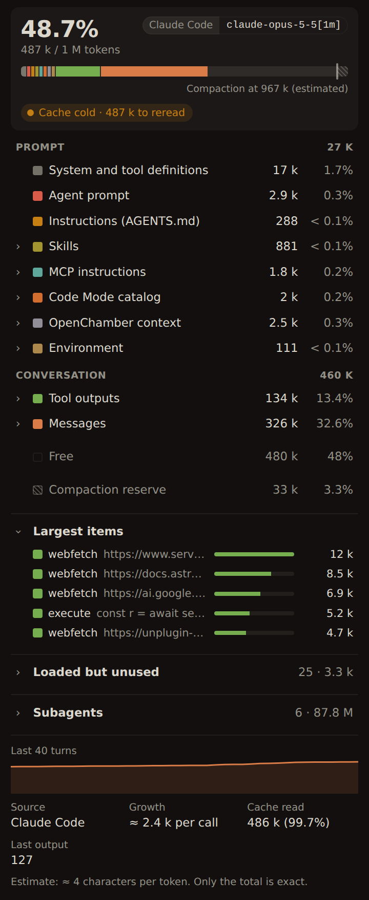
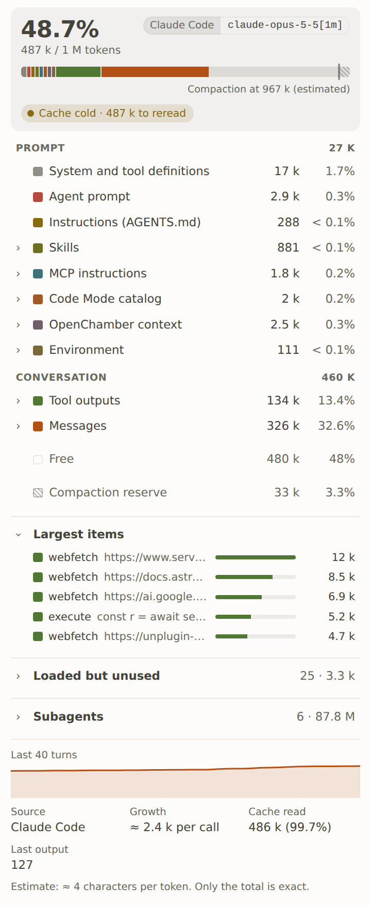
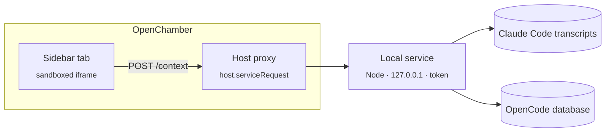

<div align="center">

# Context

**Claude Code's `/context`, for the session open in OpenChamber.**

A read-only breakdown of the context window of the open session in [OpenChamber](https://github.com/openchamber/openchamber): what fills it, how close compaction is, whether the cache is still warm, and what sits in the prompt for nothing.


<br />

<table>
  <tr>
    <td align="center" width="50%"><br /><sub>Sidebar tab, dark theme</sub></td>
    <td align="center" width="50%"><br /><sub>Sidebar tab, light theme</sub></td>
  </tr>
</table>

</div>

---

## Why

A long agent session fills its window with things you never see: skills, MCP instructions, tool catalogs, big tool outputs. Context shows **where the tokens go** in a sidebar tab, so you know when compaction is near, what a cold cache will cost on the next message, and which skills or servers you could unload.

## Features

| | |
|---|---|
| 🧮 **Window usage** | Total of the last call against the model's window, a stacked bar and a legend by category. Each category unfolds: skills, MCP servers, instruction files, tools, messages. |
| 📉 **Compaction** | Auto-compaction threshold on the bar, average growth per call over the last 10 calls, and the curve of the last 40 calls. |
| 🔥 **Cache state** | Warm, or expired with what the next message will read again without cache. |
| 🏋️ **Largest items** | The biggest pieces of the context: a tool output, a skill… |
| 💤 **Loaded for nothing** | Skills, MCP servers and Code Mode namespaces present in the prompt but never called. |
| 🤖 **Subagents** | Subagents launched by the session and the tokens they processed. |
| 🌗 **Theme & language** | Follows OpenChamber's theme and `locale`: English and French, English for any other language. |
| 🔒 **Read-only by design** | Only reads session files and databases; never writes to them. |

## Quick start

> [!NOTE]
> Requires OpenChamber **2.7.0** or later. Reading OpenCode sessions needs Node **22.5** or later (`node:sqlite`).

1. Get this folder on the machine running OpenChamber.
2. In OpenChamber, open **Settings → Extensions**, paste the absolute path of the folder, then click **Add**.
3. **Approve the local service** the extension declares: it reads the session files. Without this approval, the tab cannot load anything.
4. Open the **Contexte** tab in the sidebar.

> [!TIP]
> The built files (`status/main.js`, `service/main.js`) are committed: OpenChamber compiles nothing. After changing the sources, run `bun run build`, then reload the extension.

## Using it

- **Unfold a category**: click it in the legend to see its items and their size.
- **Refresh**: nothing to click. The tab updates when the session changes and when a call ends. It never polls the service; only the cache line is recomputed locally every 30 s.

## How it works



The tab runs in a sandboxed iframe with no access to the disk. It goes through `host.serviceRequest` to a local Node service that OpenChamber starts (`contributes.service`). The service listens on `127.0.0.1` and requires the `OPENCHAMBER_SERVICE_TOKEN` token.

The service only returns ids and names (skills, tools). Texts and number formatting live in `status/i18n.ts`; adding a language means adding a `Messages` dictionary to `CATALOG`.

### Sources (read-only)

- **Claude Code** first: `~/.local/share/opencode-claude/sessions.json` maps the OpenChamber id (`ses_…`) to the transcript `~/.claude/projects/<encoded cwd>/<foreignSessionId>.jsonl`. The cache lifetime comes from `usage.cache_creation` (5 min or 1 h), the window from `~/.local/share/opencode-claude/models.json`.
- **OpenCode**: `~/.local/share/opencode/opencode.db` through `node:sqlite`. Format 2.x (`session_message`), then the older format (`message`, `part`). Window from `~/.cache/opencode/models.json`.
- **Prompt blocks**: `instruction_state` and `instruction_blob` (skills, AGENTS.md, MCP instructions, Code Mode catalog, OpenChamber context, environment), and the agent's `.md` file.
- **Subagents**: `session_v2.parent_id`.
- **Compaction**: `compaction.buffer` from the `opencode.json(c)` files (global, project, `.opencode/`), 15 % and at least 16 k by default ([docs](https://opencode.ai/docs/compaction/)). Claude Code: a 33 k reserve observed in `/context`, shown as estimated.

### Service API

| Route | Body | Response |
|---|---|---|
| `GET /health` | | `{}` |
| `POST /context` | `{ sessionId, model }` | `{ status: 'ok', … }`, `{ status: 'no-turn', source }` or `{ status: 'not-found', reason }` |

`/context` always answers `200`: every problem comes back as a `reason` the tab words (`bad-request`, `no-session`, `no-data`, `node-too-old`, `database-unreadable`, `transcript-unreadable`, `failed`). The full shape is `ContextReport` in `service/breakdown.ts`.

## Limits

- Only the total is exact. Everything else is estimated at 4 characters per token; the items under *Messages* are a proportional split.
- *System and tool definitions* is a remainder: tool schemas are stored nowhere.
- *Loaded for nothing* spots calls by tool name and by `tools.<server>` in Code Mode scripts; an indirect use can slip through.
- Without a known cache lifetime (OpenCode), 5 min is assumed and the line says *probably*.
- A Claude Code session resumed in a new transcript only shows the current transcript.

## Development

```sh
bun install
bun run build   # status/main.js (browser) + service/main.js (Node), via openchamber-guest-bundle
bun run check   # openchamber-guest-check
```

<details>
<summary><strong>Project layout</strong></summary>

```
package.json             manifest (openchamber.contributes: panel, service)
status/index.html        page loaded in the iframe
status/main.ts           tab orchestration: host events, loading, stale answers dropped
status/view.ts           rendering and styles
status/i18n.ts           EN / FR dictionaries and number formatting
service/main.ts          local HTTP service, Claude Code then OpenCode
service/claude-code.ts   Claude Code transcript reader
service/opencode.ts      OpenCode database reader
service/prompt-parts.ts  system prompt blocks
service/subagents.ts     child sessions
service/compaction.ts    compaction buffer from the settings
service/limits.ts        model window size
service/breakdown.ts     report: categories, contributors, cache, unused items
docs/screenshots/        README screenshots
```

</details>
